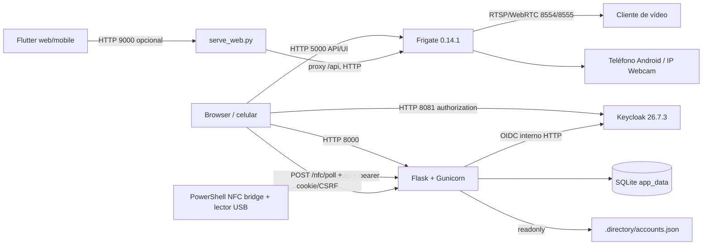
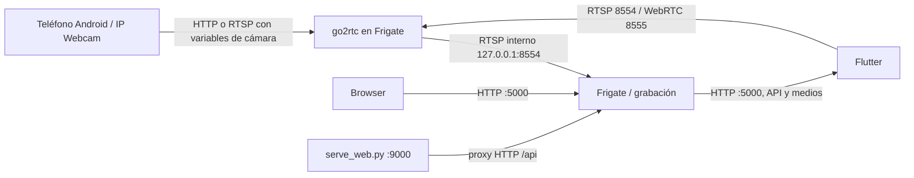

# Arquitectura técnica

## Índice

- [Componentes y redes](#componentes-y-redes)
- [Flujo de login OIDC](#flujo-de-login-oidc)
- [Flujo NFC](#flujo-nfc)
- [Flujo de vídeo](#flujo-de-vídeo)
- [Persistencia](#persistencia)
- [Límites y controles](#límites-y-controles)

## Componentes y redes



Compose declara los servicios `keycloak`, `app` y `frigate`, y crea volúmenes nombrados `keycloak_data` y `app_data`. Los mapeos de puertos no especifican una dirección de host: 8081→8080, 8000→8000, 8971, 5000, 8554 y 8555 TCP/UDP; por tanto Docker puede exponerlos en las interfaces del host y el firewall decide quién llega. La red de Compose permite a la app llamar a Keycloak por `keycloak:8080`; los puertos 9000 y los endpoints `8554`/`8555` del diagrama pertenecen al servidor Flutter opcional y a Frigate, respectivamente. (compose.yaml:20-23,66-68,101-106,108-110; iniciar-movil.ps1:28-37; modules/mobile_flutter/tools/serve_web.py:7-9,26-37,67-71)

El servicio móvil se sirve fuera de Compose, en `0.0.0.0:$PORT` (9000 por defecto); su proxy copia peticiones `/api/` al Frigate HTTP en `127.0.0.1:5000` y anuncia CORS `*`. No es un proxy autenticado. (modules/mobile_flutter/tools/serve_web.py:8-19,26-48,67-71)

| Servicio | Imagen/ejecución | Puertos del host | Persistencia y healthcheck |
|---|---|---|---|
| Keycloak | `quay.io/keycloak/keycloak:26.7.3`; `start-dev --import-realm` | 8081→8080 | Volumen `keycloak_data`; healthcheck a 9000 |
| Flask | Dockerfile local, Gunicorn | 8000→8000 | Volumen `app_data`; `/health` |
| Frigate | `ghcr.io/blakeblackshear/frigate:${FRIGATE_VERSION:-0.14.1}` | 8971, 5000, 8554, 8555 TCP/UDP | Directorios `frigate/config`, `frigate/storage`, tmpfs; no hay healthcheck definido |

Fuentes: compose.yaml:1-27,31-73,79-110; Dockerfile:1-14.

`modules/video/compose.yml` es una composición alternativa fuera del Compose raíz y fija Frigate 0.17.1; no debe confundirse con el servicio del MVP, cuyo default es 0.14.1. (modules/video/compose.yml:1-22; compose.yaml:79-81)

## Flujo de login OIDC

1. El navegador pide `/login`; la app compara `request.host` con el `netloc` de `APP_BASE_URL` y, si difiere, redirige al URL configurado.
2. Authlib inicia autorización OIDC con callback `APP_BASE_URL/auth/callback`; el navegador llega a Keycloak por el URL público.
3. La app obtiene metadata y tokens y resuelve `sub` y correo. En el callback busca una cuenta local activa y vincula el `sub` solo si aún no estaba vinculado.
4. La sesión Flask guarda el ID local (`uid`) y un token CSRF. Cada ruta protegida vuelve a comprobar usuario activo y permiso efectivo en SQLite.

La app usa metadata interna para solicitudes de servidor y una ruta proxy de metadata que sustituye token/userinfo/JWKS por URLs de la red Compose. El realm actual permite Authorization Code y Direct Access Grants; no requiere SSL (`sslRequired: none`). (app/wsgi.py:48-57,100-135,224-237,252-277; app/store.py:191-213; keycloak/identity-access-realm.json:3-17,34-60)

```mermaid
sequenceDiagram
  participant B as Browser
  participant A as Flask :8000
  participant K as Keycloak :8081 / keycloak:8080
  participant D as SQLite
  B->>A: GET /login
  A-->>B: Redirect OIDC + callback
  B->>K: Authorization Code
  K-->>B: Redirect /auth/callback?code=...
  B->>A: GET /auth/callback
  A->>K: Intercambio de código / userinfo
  A->>D: Resolver email, estado y sub
  A-->>B: Cookie de sesión firmada; redirect /
```

## Flujo NFC

El puente PowerShell lee el UID del lector USB ACR122U y envía un POST autenticado por `NFC_BRIDGE_TOKEN` a `/nfc/tap`. La app normaliza UID, comprueba tarjeta y cuenta activa, y crea un toque pendiente. El navegador con cookie y CSRF consulta `/nfc/poll`; el toque se consume una sola vez dentro de la ventana TTL, por defecto 15 segundos (mínimo 5 segundos). Para convertir el UID en sesión, la app busca la contraseña en este orden: variables `NFC_LOGIN_USERNAME`/`NFC_LOGIN_PASSWORD` para esa cuenta, `user_credentials` descifrada, archivo privado de directorio, `NFC_PASSWORD_<USUARIO>` y, por último, variable de contraseña demo asociada. Luego usa el grant `password` de OIDC y solo abre sesión si Keycloak devuelve identidad con correo y `sub` que coinciden con un usuario local activo. (tools/nfc-bridge.ps1:22-27,83-115; app/wsgi.py:60-135,332-373; app/store.py:266-303)

```mermaid
sequenceDiagram
  participant C as Tarjeta NFC (UID)
  participant R as Lector USB / puente PowerShell
  participant A as Flask
  participant D as SQLite
  participant B as Browser
  participant K as Keycloak
  C->>R: UID por APDU
  R->>A: POST /nfc/tap + Bearer token
  A->>D: Valida lista blanca y encola tap
  B->>A: POST /nfc/poll + sesión/CSRF
  A->>D: Reclama un tap no consumido dentro TTL
  A->>K: Direct Access Grant con credencial almacenada
  K-->>A: Token e identidad
  A-->>B: login=true; fija uid y CSRF en sesión
```

El UID es el dato que lee y transmite el puente; no aparece un desafío criptográfico con la tarjeta. El endpoint de bridge sí compara bearer token en tiempo constante, pero el token circula sobre HTTP cuando se usa la URL local del script. Esto es aceptable solo como demostración local aislada, no como autenticación física robusta. (tools/nfc-bridge.ps1:22-27,112-115; app/wsgi.py:332-373)

## Flujo de vídeo



Frigate configura `cam_entrada` habilitada y `cam_interior` deshabilitada; las fuentes usan las variables de IP/usuario/contraseña y la cámara de entrada está conectada a go2rtc por RTSP local. El host publica 5000 HTTP, 8554 RTSP y 8555 TCP/UDP WebRTC. La autenticación de Frigate está deshabilitada en la configuración actualmente presente. (frigate/config/config.yml:10-11,34-56,66-93; compose.yaml:89-106)

## Persistencia

SQLite se crea en `APP_DB` (por defecto `/srv/data/lab.sqlite`) y contiene cuentas, permisos, eventos, tarjetas, taps y credenciales cifradas. El contenedor monta `/srv/data` como volumen persistente, el directorio privado como solo lectura y Keycloak usa su propio volumen. Frigate persiste su configuración y medios en bind mounts de host. (app/wsgi.py:46; app/store.py:68-75; compose.yaml:22-24,63-65,94-99)

## Límites y controles

- La configuración de Compose es de desarrollo (`start-dev`) y publica HTTP sin fijar interfaz de host; las credenciales se inyectan por variables de entorno. (compose.yaml:3-18,20-21,31-50,66-68)
- La cookie es `HttpOnly`, `SameSite=Lax`, 15 minutos, y `Secure` solo si `APP_BASE_URL` comienza con `https://`; `AUTHLIB_INSECURE_TRANSPORT=1` se define en Compose. (app/wsgi.py:33-45; compose.yaml:45)
- El token SCIM autoriza todas las operaciones SCIM, incluida lectura global y cambios de cuenta; no se aprecia separación por operación/tenant en estas rutas. (app/wsgi.py:167-174,632-697)
- La aplicación limita request bodies a 2 MiB, pero no se configura limitación de intentos ni un sistema de cabeceras CSP/HSTS/X-Frame-Options en `create_app`. (app/wsgi.py:33-39)
- `APP_SECRET` también deriva la clave Fernet de las credenciales; cambiarlo sin migrar/cifrar de nuevo las filas existentes impide descifrarlas. (app/store.py:306-347)
- El acceso NFC y la interfaz/streams de Frigate son controles propios de laboratorio; para datos reales se requieren TLS, autenticación, segmentación de red, credenciales únicas de cámara y controles de operación adicionales. (compose.yaml:89-106; frigate/config/config.yml:10-11)
