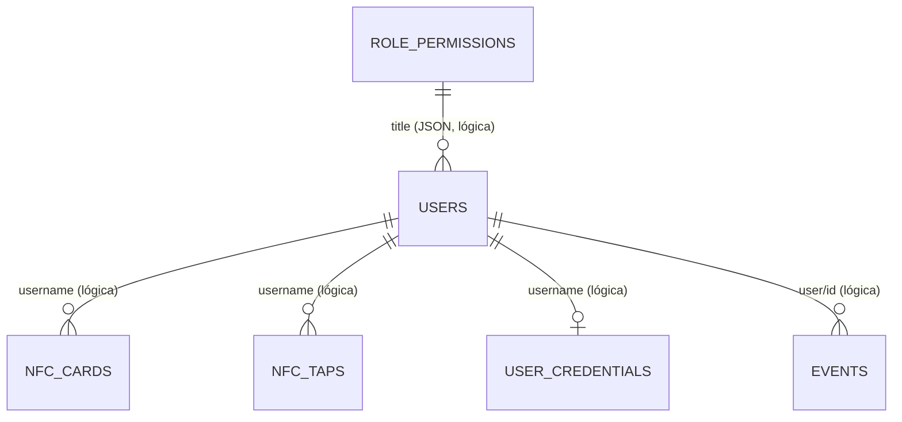

# Modelo de datos SQLite

## Índice

- [Resumen](#resumen)
- [Tablas](#tablas)
- [Relaciones y restricciones](#relaciones-y-restricciones)
- [Ciclo de vida](#ciclo-de-vida)

## Resumen

La app abre SQLite en `APP_DB` (valor predeterminado `/srv/data/lab.sqlite`) y crea siete tablas con `CREATE TABLE IF NOT EXISTS`; los datos se guardan en el volumen Docker `app_data`. No se declaran claves foráneas ni índices secundarios en el esquema visible. (app/wsgi.py:46; app/store.py:68-75; compose.yaml:63-65)

## Tablas

| Tabla | Columnas y tipos | Claves / contenido |
|---|---|---|
| `users` | `id TEXT`, `username TEXT`, `payload TEXT`, `oidc_sub TEXT` | `id` PK; `username` UNIQUE NOT NULL; `payload` JSON del recurso SCIM (incluye perfil, estado, rol, permisos extra, `meta`); `oidc_sub` UNIQUE nullable. |
| `events` | `time TEXT`, `user TEXT`, `action TEXT`, `result TEXT` | Todas NOT NULL; historial append por app, sin ID explícito; recortado a los últimos 500 registros. |
| `nfc_cards` | `uid TEXT`, `username TEXT`, `label TEXT`, `created_at TEXT` | `uid` PK; nombre y fecha NOT NULL; label NOT NULL con default vacío. |
| `nfc_taps` | `id INTEGER`, `uid TEXT`, `username TEXT`, `source TEXT`, `created_at TEXT`, `consumed INTEGER` | `id` PK autoincremental; uid, username y fecha NOT NULL; source default vacío; consumed default 0. |
| `role_permissions` | `role TEXT`, `permissions TEXT` | `role` PK; permisos serializados como JSON. |
| `user_credentials` | `username TEXT`, `secret TEXT`, `updated_at TEXT` | `username` PK; `secret` contiene token Fernet, `updated_at` ISO UTC. |
| `app_meta` | `key TEXT`, `value TEXT` | `key` PK; value NOT NULL; marca de migración de permisos. |

Fuente del DDL: `app/store.py:68-75`. Campos de usuario se normalizan y validan en `app/store.py:139-164`; `payload` se serializa JSON en `app/store.py:165-181`.

## Relaciones y restricciones

Las líneas del diagrama son relaciones lógicas, no constraints SQLite: el DDL no declara `FOREIGN KEY`. Las tablas NFC/credenciales enlazan por string de username, y el rol vive dentro de `users.payload`. Las cuentas usan UUID generado por `uuid.uuid4`; el username se almacena en minúsculas y `oidc_sub` impide que un subject de Keycloak se enlace a dos filas. (app/store.py:68-75,165-181,191-205,232-250,306-347)

## Ciclo de vida

- Usuarios: `save` crea/actualiza `payload` y la columna `username`; `deactivate` marca `active=false`, no borra el registro. (app/store.py:165-189)
- Eventos: se insertan con fecha UTC y se eliminan registros anteriores al límite de 500; la API devuelve máximo 100. (app/store.py:216-223)
- NFC: UID se normaliza a hexadecimal mayúsculo sin separadores; taps se reclaman una sola vez y se eliminan los expirados respecto al TTL. (app/store.py:31-48,232-303)
- Credenciales: Fernet con derivación determinista de `APP_SECRET`; exportación convierte el ciphertext a contraseña en claro dentro del bundle JSON. (app/store.py:306-379)
- Respaldo `replace`: desactiva usuarios no incluidos y elimina antes las tarjetas/credenciales, luego carga las del archivo y permisos. La secuencia no usa una transacción que englobe todos los pasos. (app/store.py:442-478)

No se inspeccionaron archivos privados ni las bases ya persistidas; contenido/estado de esas instancias es **NO VERIFICADO**.
